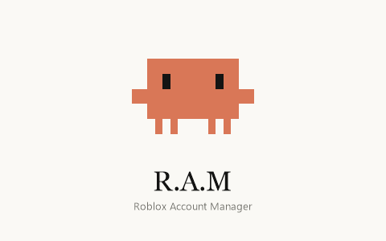

<p align="center"></p>

# R.A.M — Roblox Account Manager

Gerenciador de contas do Roblox com **multi-instância**, no visual do Claude Desktop e com o **Clawd** de mascote.

## Instalar

Baixe o **`RAM.AccountManager-win-Setup.exe`** da [última release](https://github.com/huginhohenriquerl-ops/RAM-Roblox-Account-Manager/releases/latest)
e execute. Não precisa de administrador; se faltar o .NET 8 Desktop Runtime, o instalador baixa sozinho.

O R.A.M se **atualiza sozinho**: ao abrir (e a cada 4 horas) ele procura uma release nova aqui no GitHub, baixa em
segundo plano e mostra "Versão X pronta · Reiniciar".

## Recursos

- **Multi-instância** — várias janelas do Roblox ao mesmo tempo. Técnica reconstruída por engenharia reversa do
  [MultiBloxy](https://github.com/Zgoly/MultiBloxy) e melhorada; detalhes em [docs/MultiBloxy-RE.md](docs/MultiBloxy-RE.md).
  Funciona enquanto o R.A.M estiver aberto (ele fica na bandeja).
- **Nova instância do Roblox** — abre outra janela sem conta salva; o login é feito na tela do próprio Roblox.
- **Contas salvas** — cada conta é validada no Roblox e guardada em `%LOCALAPPDATA%\RAM\accounts.dat`,
  criptografada com DPAPI (só o seu usuário do Windows consegue ler).
- **Abrir em jogos** — selecione uma ou mais contas (Ctrl/Shift + clique), cole um Place ID, link de jogo, link de
  servidor privado ou um Job ID e aperte Enter. Mostra a prévia do jogo e espera um intervalo entre as contas.
- **Instâncias** — lista os `RobloxPlayerBeta` abertos com a conta de cada um, renomeia as janelas, foca ou fecha.
- Tema claro/escuro, ícone na bandeja e o Clawd reagindo a tudo.

## Desenvolvimento

Requer o .NET 8 SDK.

```bash
dotnet build -c Release
```

- `tools/pack.ps1 -Version 1.2.3` gera o instalador localmente em `Releases/` (precisa do `vpk`: `dotnet tool install -g vpk`).
- `tools/make-icon.ps1` regenera `Assets/ram.ico` e `Assets/splash.png` a partir do sprite do Clawd.

### Publicar uma versão

Atualize `<Version>` em `RAM.csproj`, faça commit e envie uma tag:

```bash
git tag v1.0.1
git push origin v1.0.1
```

O workflow [`release.yml`](.github/workflows/release.yml) compila, gera o instalador (com pacotes delta) e publica a release.
As cópias instaladas recebem a atualização automaticamente.

## Aviso

Projeto não oficial, sem vínculo com a Roblox Corporation. Nunca compartilhe o cookie `.ROBLOSECURITY` de uma conta com ninguém.
